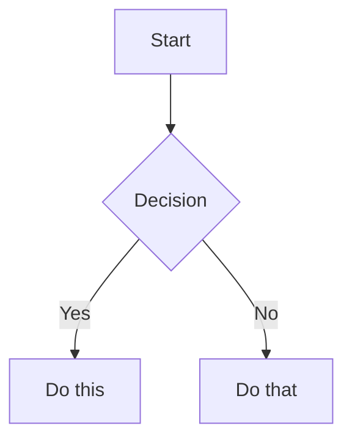

# Obsidian Flavored Markdown Skill

Create and edit valid Obsidian Flavored Markdown. Obsidian extends CommonMark and GFM with wikilinks, embeds, callouts, properties, comments, and other syntax. This skill covers only Obsidian-specific extensions -- standard Markdown (headings, bold, italic, lists, quotes, code blocks, tables) is assumed knowledge.

## Workflow: Creating an Obsidian Note

1. **Choose a note profile** from the guidance below and include only sections that serve the user's task.
2. **Add normalized frontmatter** with accurate properties. See [PROPERTIES.md](references/PROPERTIES.md) for all property types.
3. **Write accessible content** using standard Markdown plus Obsidian syntax. Apply the semantic icon and information-density rules below.
4. **Add navigation** when the note is long enough to benefit from a summary or table of contents.
5. **Link related notes** using wikilinks (`[[Note]]`) for internal vault connections, or standard Markdown links for external URLs.
6. **Embed content** from other notes, images, or PDFs using `![[embed]]`. See [EMBEDS.md](references/EMBEDS.md) for all embed types.
7. **Use callouts selectively** for exceptional information. See [CALLOUTS.md](references/CALLOUTS.md) for all callout types.
8. **Run the final quality gate** and verify the note in Obsidian's reading view when available.

> When choosing between wikilinks and Markdown links: use `[[wikilinks]]` for notes within the vault (Obsidian tracks renames automatically) and `[text](url)` for external URLs only.

## Semantic Icons (Required)

Use semantic Unicode icons to improve visual hierarchy and scanning in every generated or substantially edited note.

- Add one meaningful icon to the document title and to major section headings or important labels. Use a restrained subset appropriate to the note; do not add icons to every paragraph or bullet.
- Keep each icon's meaning consistent throughout the document. Prefer one icon per heading or label.
- Always pair an icon with descriptive text. Never use an icon as the only carrier of meaning, status, or instruction.
- Choose icons for semantics, not decoration. Avoid ambiguous, repeated, or tone-inappropriate emoji.
- Preserve readability in plain text, accessibility, search, and heading links. When linking to a heading containing an icon, include the icon in the heading reference, for example `[[#🔐 Security]]`.

Recommended default vocabulary:

| Meaning | Icon |
|---|---|
| Overview, scope, navigation | 🧭 |
| Key point or summary | 📌 |
| Architecture or structure | 🏗️ |
| Process or reactive flow | 🔄 |
| API or integration | 🔌 |
| Configuration | ⚙️ |
| Data or persistence | 🗄️ |
| Messaging or events | 📨 |
| Security | 🔐 |
| Tests or validation | 🧪 |
| Metrics or observability | 📊 |
| Delivery or deployment | 🚀 |
| Confirmed or completed | ✅ |
| Warning or risk | ⚠️ |
| Recommendation or idea | 💡 |
| Question, inference, or unknown | ❓ |

Extend this vocabulary only when the note's domain needs a clearer icon. Reuse the same icon for the same concept within a note or related note set.

## Output Design Rules (Required)

### Choose a Note Profile

Match the structure to the note's purpose. Do not force irrelevant sections.

| Note type | Recommended structure |
|---|---|
| Technical assessment or reference | Summary, scope, confirmed evidence, inferences, findings, risks, recommendations, sources |
| Architecture decision record | Context, decision, options considered, consequences, status |
| Tutorial or guide | Outcome, prerequisites, ordered steps, verification, troubleshooting |
| Runbook | Purpose, safety/prechecks, procedure, validation, rollback, escalation |
| Incident review | Impact, timeline, detection, root cause, response, corrective actions |
| API or data reference | Contract/schema, authentication, examples, errors, constraints, versioning |
| General note | Short summary, focused content, related notes |

### Normalize Frontmatter

- Always include `title`. Use ISO `YYYY-MM-DD` for `date` and `updated` when those properties are relevant.
- Add a small set of specific, reusable `tags`; prefer nested tags when they express a stable hierarchy.
- Add `aliases` only when they improve discovery. Add `status`, `owners`, or `version` only when known and useful.
- Preserve existing user-defined properties and types when editing. Never invent metadata values that cannot be derived safely.
- Keep property names and lifecycle values consistent across related notes.

### Preserve Traceability and Certainty

For assessments, investigations, research, and other evidence-based notes, distinguish statements consistently:

- `✅ Confirmed`: directly supported by inspected evidence.
- `❓ Inference`: reasoned interpretation that still needs validation.
- `🔎 Not determined`: unavailable or insufficient evidence.
- `💡 Recommendation`: proposed action, not an observed fact.

Use callouts, labels, or a compact table depending on the document. Place sources close to the claims they support, and never present an inference as confirmed.

### Adapt Navigation and Information Density

- For a note longer than roughly 800 words or six major sections, add a concise summary and a table of contents using same-note heading links such as `[[#🔐 Security]]`.
- Use one H1 title and sequential heading levels. Avoid bold text as a substitute for headings.
- Use prose for explanation, numbered lists for ordered procedures, bullets for scan-friendly sets, and tables for repeated-field comparisons.
- Use Mermaid only when relationships, hierarchy, or sequence become materially clearer than prose.
- Keep each callout focused on one exceptional idea. Do not wrap ordinary paragraphs in callouts.
- For long analytical notes, close with conclusions, decisions, or next actions when the task benefits from them.

### Maintain Link Hygiene and Accessibility

- Verify internal wikilink, heading, block, and embed targets when the vault contents are available. Mark intentionally unresolved links instead of silently implying they exist.
- Use descriptive aliases and external-link labels; avoid vague labels such as `click here`.
- Keep the complete meaning in text. Do not rely only on icons, color, callout styling, or link placement.
- Add language identifiers to code fences and readable labels to tables, diagrams, images, and embeds when the syntax permits.
- Keep headings stable and descriptive. Include the icon when linking to a heading that contains one.

## Final Quality Gate (Required)

Before delivering a created or substantially edited note, verify:

- Frontmatter is valid YAML with matching delimiters, appropriate property types, and no duplicate keys.
- The note has one H1, sequential headings, balanced code fences, valid tables, and correctly formed callouts.
- Semantic icons are meaningful, restrained, consistent, and paired with text.
- Wikilinks, heading links, block links, embeds, and external URLs use the correct syntax and resolve when they can be checked.
- Mermaid blocks parse and add real explanatory value.
- Facts, inferences, unknowns, and recommendations are distinguishable when evidence matters.
- The output is concise, task-specific, accessible in plain text, and free of decorative clutter.
- The note renders correctly in Obsidian reading view. If Obsidian is unavailable, validate the source structure and state that visual rendering was not verified.

## Internal Links (Wikilinks)

```markdown
[[Note Name]]                          Link to note
[[Note Name|Display Text]]             Custom display text
[[Note Name#Heading]]                  Link to heading
[[Note Name#^block-id]]                Link to block
[[#Heading in same note]]              Same-note heading link
```

Define a block ID by appending `^block-id` to any paragraph:

```markdown
This paragraph can be linked to. ^my-block-id
```

For lists and quotes, place the block ID on a separate line after the block:

```markdown
> A quote block

^quote-id
```

## Embeds

Prefix any wikilink with `!` to embed its content inline:

```markdown
![[Note Name]]                         Embed full note
![[Note Name#Heading]]                 Embed section
![[image.png]]                         Embed image
![[image.png|300]]                     Embed image with width
![[document.pdf#page=3]]               Embed PDF page
```

See [EMBEDS.md](references/EMBEDS.md) for audio, video, search embeds, and external images.

## Callouts

```markdown
> [!note]
> Basic callout.

> [!warning] Custom Title
> Callout with a custom title.

> [!faq]- Collapsed by default
> Foldable callout (- collapsed, + expanded).
```

Common types: `note`, `tip`, `warning`, `info`, `example`, `quote`, `bug`, `danger`, `success`, `failure`, `question`, `abstract`, `todo`.

See [CALLOUTS.md](references/CALLOUTS.md) for the full list with aliases, nesting, and custom CSS callouts.

## Properties (Frontmatter)

```yaml
---
title: My Note
date: 2024-01-15
tags:
  - project
  - active
aliases:
  - Alternative Name
cssclasses:
  - custom-class
---
```

Default properties: `tags` (searchable labels), `aliases` (alternative note names for link suggestions), `cssclasses` (CSS classes for styling).

See [PROPERTIES.md](references/PROPERTIES.md) for all property types, tag syntax rules, and advanced usage.

## Tags

```markdown
#tag                    Inline tag
#nested/tag             Nested tag with hierarchy
```

Tags can contain letters, numbers (not first character), underscores, hyphens, and forward slashes. Tags can also be defined in frontmatter under the `tags` property.

## Comments

```markdown
This is visible %%but this is hidden%% text.

%%
This entire block is hidden in reading view.
%%
```

## Obsidian-Specific Formatting

```markdown
==Highlighted text==                   Highlight syntax
```

## Math (LaTeX)

```markdown
Inline: $e^{i\pi} + 1 = 0$

Block:
$$
\frac{a}{b} = c
$$
```

## Diagrams (Mermaid)

````markdown

````

To link Mermaid nodes to Obsidian notes, add `class NodeName internal-link;`.

## Footnotes

```markdown
Text with a footnote[^1].

[^1]: Footnote content.

Inline footnote.^[This is inline.]
```

## Complete Example

````markdown
---
title: Project Alpha
date: 2024-01-15
tags:
  - project
  - active
status: in-progress
---

# 🧭 Project Alpha

This project aims to [[improve workflow]] using modern techniques.

> [!important] 📅 Key Deadline
> The first milestone is due on ==January 30th==.

## ✅ Tasks

- [x] Initial planning
- [ ] Development phase
  - [ ] Backend implementation
  - [ ] Frontend design

## 📝 Notes

The algorithm uses $O(n \log n)$ sorting. See [[Algorithm Notes#Sorting]] for details.

![[Architecture Diagram.png|600]]

Reviewed in [[Meeting Notes 2024-01-10#Decisions]].
````

## References

- [Obsidian Flavored Markdown](https://help.obsidian.md/obsidian-flavored-markdown)
- [Internal links](https://help.obsidian.md/links)
- [Embed files](https://help.obsidian.md/embeds)
- [Callouts](https://help.obsidian.md/callouts)
- [Properties](https://help.obsidian.md/properties)
